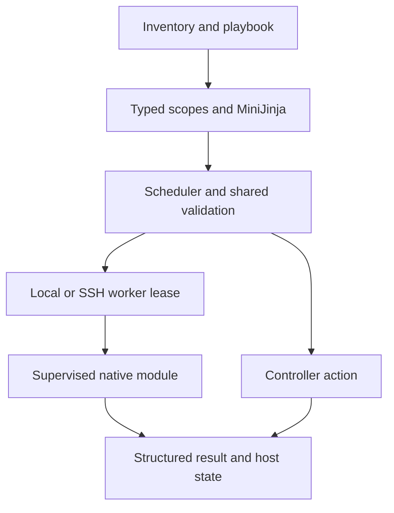

[English / 简体中文](../../zh-CN/development/architecture.md) · [Index / 目录](../index.md)

# Architecture and request lifecycle

## Execution boundaries

The controller owns inventory/playbook parsing, typed scopes, MiniJinja, scheduling and credential input. The protocol crate owns framed requests/results and capability validation. Native helpers own supervision, staging, protection and archive preflight. The worker has no inventory, SSH or playbook parser. Controller actions stay local; target modules use the same worker for local/SSH.

## Worker lease lifecycle

Identify Linux/architecture/UID, verify local ELF/SHA, stream into a private target directory, verify again, validate version/build/capabilities, then send requests through stdin. Large payloads stream outside JSON. Configuration/identity changes or reset_connection replace the lease. EOF/timeout cancels synchronous descendants; successful service management may hand daemons to the OS. Async jobs have a separate protected supervisor lifecycle.

## Invariants for contributors

Do not add a second dispatcher, template engine, variable table or Python fallback. Validate before mutation. Pin target directory descriptors, retain metadata, commit atomically. A transport loss after mutation can be uncertain; never quietly replay. Keep machine-readable stdout separate from diagnostic stderr.
