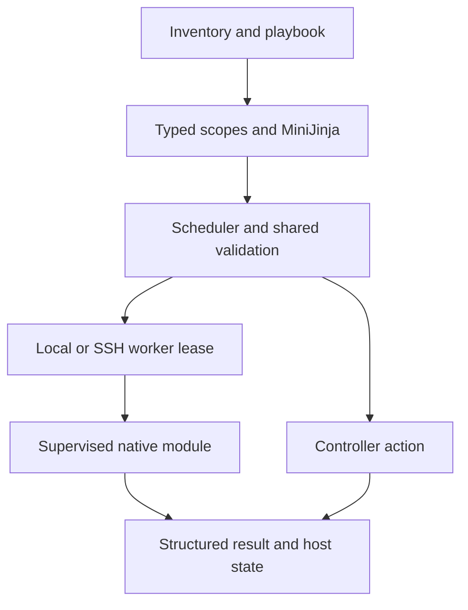

[English / 简体中文](../../en/development/architecture.md) · [Index / 目录](../index.md)

# 架构与请求生命周期

## 执行边界

控制端负责 inventory/playbook 解析、类型作用域、MiniJinja、调度、凭据输入。协议 crate 负责分帧请求/结果和能力校验，原生公共组件负责监督、暂存、保护元数据与归档预检。worker 不含 inventory、SSH 或 playbook 解析器；控制端动作留在本地，目标模块在 local/SSH 共用 worker。

## Worker 租约生命周期

识别 Linux/架构/UID，校验本地 ELF/SHA，流式传到目标私有目录，再校验版本/构建/能力，通过 stdin 传请求；大文件在 JSON 外流传。配置/身份变化或 reset_connection 更换租约；EOF/超时取消同步后代，成功服务管理可交由操作系统托管守护进程。async 使用独立私有监督生命周期。

## 贡献者须维护的约束

不要增加第二套分发器、模板引擎、变量表或 Python 回退。修改前完整校验；固定目标目录描述符、保留元数据并原子提交。修改后失联可以是 uncertain，不得静默重放；机器可读 stdout 与诊断 stderr 分开。
